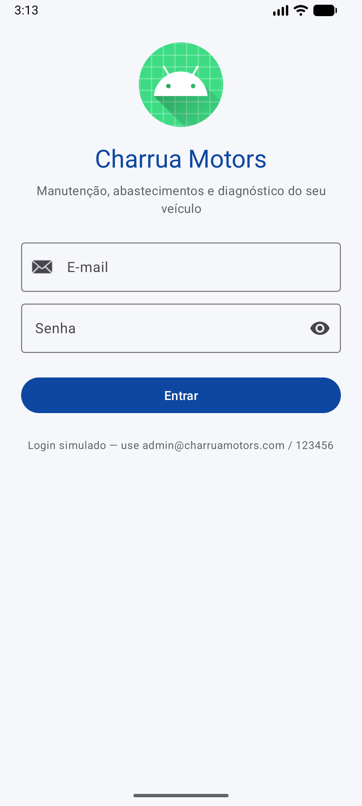
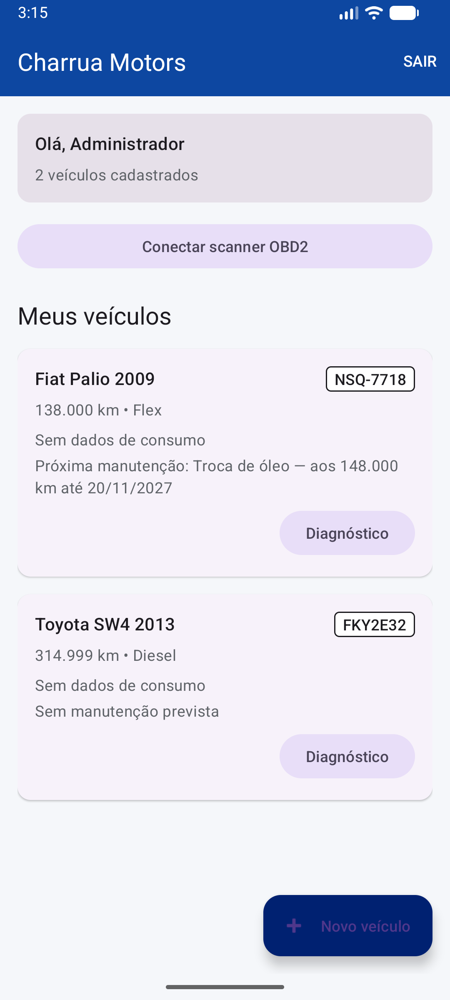
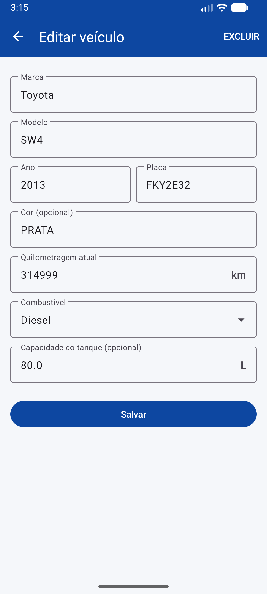
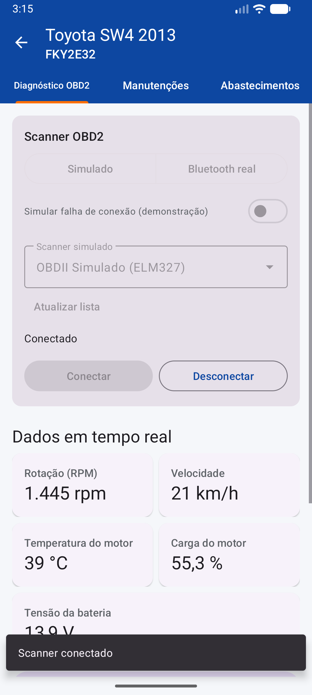
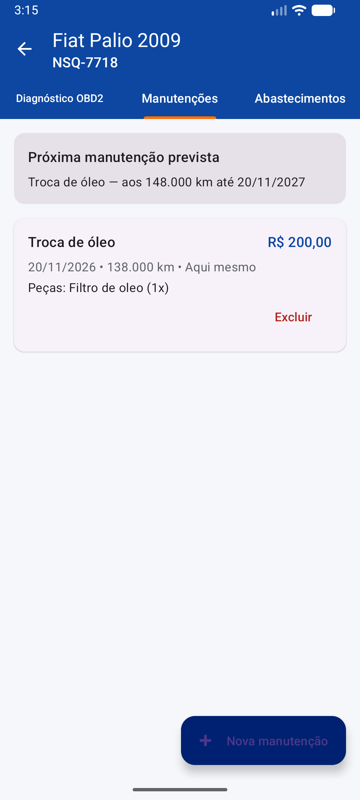
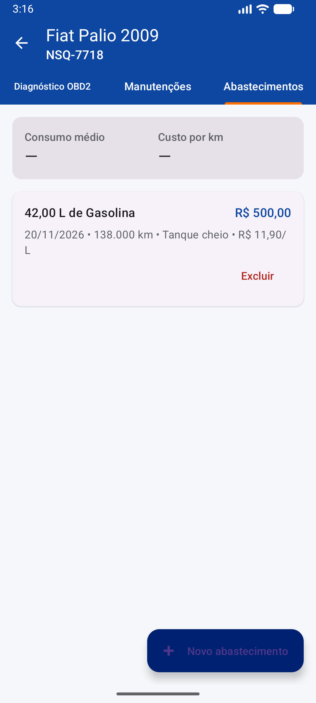

# Prints das telas — Charrua Motors

Dupla: Giuliano Chiochetta Lagni (199805) e Hugo Pizzatto (193213).

Capturas feitas no emulador, com o scanner OBD2 em modo **Simulado**. Fluxo do app: `Login → Dashboard → (Formulário de veículo | Diagnóstico)`.

---

## 1. Login — `LoginActivity`

Tela de entrada com e-mail e senha (campos com validação no próprio campo). O login é simulado: as credenciais são conferidas na tabela de usuários do Room e a sessão fica salva em `SharedPreferences`. O usuário padrão aparece como dica na tela.

## 2. Dashboard — `DashboardActivity`

Tela inicial após o login. Lista os veículos cadastrados (`RecyclerView`) com km atual, combustível, consumo médio e próxima manutenção prevista. Tem o botão "Novo veículo", o atalho "Conectar scanner OBD2", o botão "Diagnóstico" em cada card e a ação "Sair" na Toolbar.

## 3. Formulário de veículo — `VeiculoFormActivity`

CRUD de veículos. Aberta a partir de um card do Dashboard, carrega os dados do veículo para edição (marca, modelo, ano, placa, cor, km, combustível e capacidade do tanque). "Salvar" atualiza o registro e "Excluir" na Toolbar remove o veículo, com confirmação. Aberta pelo botão "Novo veículo", a mesma tela cadastra um veículo vazio.

## 4. Diagnóstico OBD2 — `DiagnosticoActivity` (aba 1)

Primeira aba do `TabLayout` + `ViewPager2`. Permite escolher entre scanner simulado e Bluetooth real, conectar e desconectar. Com o scanner conectado, mostra os dados em tempo real: RPM, velocidade, temperatura do motor, carga do motor e tensão da bateria.

## 5. Manutenções — `DiagnosticoActivity` (aba 2)

Segunda aba. Mostra a próxima manutenção prevista (calculada pela última troca de cada tipo) e o histórico de manutenções do veículo, com data, km, oficina, peças trocadas e custo. O botão "Nova manutenção" abre o cadastro e cada item pode ser excluído.

## 6. Abastecimentos — `DiagnosticoActivity` (aba 3)

Terceira aba. Exibe o consumo médio e o custo por km (que aparecem como "—" até haver dados suficientes, no mínimo dois tanques cheios) e o histórico de abastecimentos com litros, combustível, valor, preço por litro e se foi tanque cheio. O botão "Novo abastecimento" abre o cadastro.
